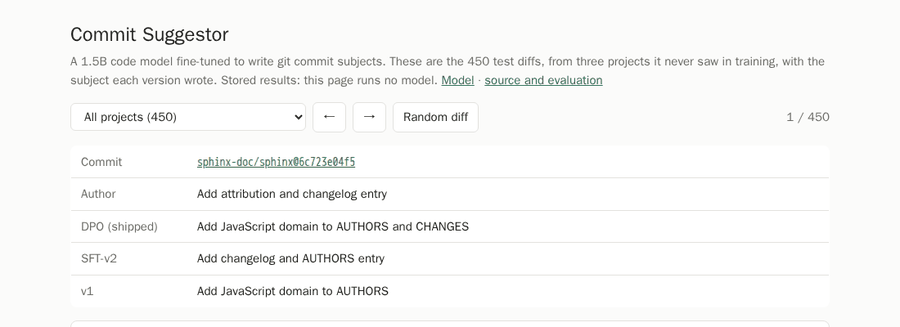

# Commit Suggestor

A 1.5B code model that writes the subject line of a git commit from the diff.
It runs locally (MLX on Apple Silicon, llama.cpp anywhere else), writes a
subject in about half a second once loaded on an M4, and can pre-fill the
message whenever you run `git commit`.

```console
$ git add -p
$ commit-suggestor
Remove redundant `displayName` from `run tox` step
```

[](https://huggingface.co/spaces/nihar-damera/commit-suggestor-demo)

[Demo page](https://huggingface.co/spaces/nihar-damera/commit-suggestor-demo) (stored results for all 450 test diffs) ·
[Model on Hugging Face](https://huggingface.co/nihar-damera/commit-suggestor)

## Results

450 commits from three projects never seen in training (django-rest-framework,
pydantic, sphinx). Means with 95% bootstrap intervals, resampled within each
project. The shipped models are scored as users run them: 4-bit, greedy, after
the length guard. Full table: [`eval/v2_results.md`](eval/v2_results.md).

| System | ROUGE-L | Specific % | Generic % | Names not in diff % | Well-formed % | Words |
| --- | ---: | ---: | ---: | ---: | ---: | ---: |
| base (prompt only) | 21.1 [19.4, 22.8] | 92.4 | 0.0 | 0.4 | 92.2 | 7.2 |
| v1 (QLoRA, 2,400 examples) | 31.1 [28.9, 33.2] | 80.7 | 6.2 | 0.4 | 98.9 | 4.7 |
| SFT-v2 (LoRA, 27K examples) | 30.2 [28.0, 32.4] | 79.3 | 8.4 | 1.1 | 100.0 | 4.4 |
| **DPO (shipped)** | **31.1 [29.1, 33.2]** | **95.6** | **0.0** | 1.6 | 100.0 | 6.3 |

LLM judge (Claude Haiku 5.5, pairwise, both orders, ties excluded):

| Comparison | Judge | Win rate |
| --- | --- | ---: |
| DPO vs SFT-v2 | rubric v1, which also labelled the DPO training pairs | 83.2% [78.8, 86.9] |
| DPO vs SFT-v2 | rubric v2, length-neutral, labelled nothing | 85.8% [81.7, 89.2] |
| DPO vs v1 | rubric v1 | 78.3% [73.6, 82.3] |
| SFT-v2 vs v1 | rubric v1 | 49.8% [44.2, 55.5] |

**Specific** = names a file or symbol the diff changes; **generic** = would fit
almost any diff ("Fix typo", "Update docs"), or was given to 3+ diffs. Both are
rules in [`commit_suggestor/metrics.py`](commit_suggestor/metrics.py), and
proxies: see below for how well they track my own ratings.

## What ROUGE missed

v1's headline was ROUGE-L 21 → 31 over the base model. Rating 150 blind pairs
myself ([`eval/rouge_vs_human.md`](eval/rouge_vs_human.md)) told a smaller story:

- I preferred v1 to base **57.5% [49.0, 65.5]** of the time, a lean and not a
  landslide. My 1–5 score rose by 0.53 [0.15, 0.90].
- ROUGE-L picked my winner only **60.0% [51.1, 68.3]** of the time, and I rated
  the author's own subject (ROUGE's "answer") 1 or 2 in **21%** of cases.
- Fine-tuning had made subjects shorter and **less specific** (−11.8 points),
  which ROUGE rewards: short, conventional subjects overlap with short,
  conventional references.

Then v2 made the same point twice:

- **SFT-v2** trained on 11× more data. Validation ROUGE-L rose with data
  (26.8 → 30.1, +3.3 [1.7, 4.9]), yet on test it ties v1 by both ROUGE and the judge.
- **DPO** changed the subjects the most of any step: generic subjects 8.4% → 0%,
  specific +16.2 points [12.7, 19.8], and both judges prefer it 83–86% of the
  time. **ROUGE-L moved +1.0 [−0.8, 2.8]: nothing.**

The judge isn't the truth either. Its agreement with my labels is Cohen's
κ = 0.23 on held-out pairs (ROUGE-L: 0.19), far from the 0.6 I aimed for
([`eval/judge_vs_human.md`](eval/judge_vs_human.md)). That's why DPO was
checked with a second rubric it was not trained against, and why a fresh blind
human comparison of DPO and SFT-v2 is part of the evaluation
([`eval/human/dpo_sample.jsonl`](eval/human/dpo_sample.jsonl)).

## Use it

```bash
pipx install "commit-suggestor[mlx] @ git+https://github.com/nihardamera/Commit-Suggestor"  # Apple Silicon
pipx install "commit-suggestor[cpu] @ git+https://github.com/nihardamera/Commit-Suggestor"  # anything else
commit-suggestor download          # the model from Hugging Face, at a pinned revision

# in any repository, after staging changes:
commit-suggestor
git diff HEAD~1 | commit-suggestor -       # or any diff on stdin

commit-suggestor install-hook              # pre-fill the message on `git commit`
commit-suggestor install-hook --feedback   # and log whether you kept it
commit-suggestor stats
```

The hook only acts on a plain `git commit` (not `-m`, merges or amends), gives
up after 20 seconds (`COMMIT_SUGGESTOR_TIMEOUT`), skips very large diffs, never
downloads inside a commit, and is off with `COMMIT_SUGGESTOR_DISABLE=1`. It
loads the model afresh for every commit, so expect a wait of several seconds
on a Mac and more on a CPU. With `--feedback`, a
`post-commit` hook records whether the suggestion was kept, edited or replaced,
in `~/.local/share/commit-suggestor/feedback.jsonl`. Nothing leaves the machine.

Model on Hugging Face:
[nihar-damera/commit-suggestor](https://huggingface.co/nihar-damera/commit-suggestor)
(MLX 4-bit and GGUF; card: [`docs/MODEL_CARD.md`](docs/MODEL_CARD.md)). The
[demo Space](https://huggingface.co/spaces/nihar-damera/commit-suggestor-demo)
is a static page with all 450 test diffs and the subject each version wrote:
Hugging Face needs PRO for Gradio Spaces, so it runs no model.
[`space/app.py`](space/app.py) is the live demo, to run locally.

## How it was built

**Data** ([`docs/DATA_CARD.md`](docs/DATA_CARD.md)). Commits mined with
`git log -p` from 17 Python projects for training and validation, plus the 3
test projects. Bots, merges, releases, reverts, huge diffs and trivial
subjects are dropped. PR numbers are stripped, near-duplicates removed with
MinHash, and each project capped so that no single one dominates. The split
is by project, never by commit. Result: 27,356 training and 600 validation
examples, with no copy of any test diff.

**SFT-v2.** LoRA (rank 8, alpha 160, top 16 of 28 layers, 5.28M trainable
parameters) on Qwen2.5-Coder-1.5B-Instruct, the same setup as v1, so that
v1 → v2 changes the data and not five things at once. One epoch with TRL on a
free Kaggle T4, loss on the subject only.

**DPO.** I sampled 4 subjects for each of 3,000 training diffs. The judge
ranked them in both orders, and 2,198 pairs were kept where both orders
agreed and the winner neither invented names nor was generic. Chosen subjects
are only 0.38 words longer than rejected ones, so the pairs don't simply
teach "longer". β ∈ {0.05, 0.1, 0.3}. The DPO loss is also written by hand
([`commit_suggestor/dpo.py`](commit_suggestor/dpo.py)) and matches TRL's on
the trained models to within 0.001.

**Choices made on validation only.** Every choice was made on 300 validation
diffs, by rules committed to code before the numbers came in
([`eval_v2.py`](commit_suggestor/eval_v2.py) `decide_context`, `choose_beta`).
Repo context (the last five subjects as input) lost, 27% [21, 35]. β = 0.3 was
picked: all three β won about 82%, but only 0.3 kept the length increase under
2 words. The test set was scored once, at the end.

**A miss, and the fix.** The β rule capped *mean* length but not the
72-character limit. DPO writes past it in 2.3% of validation and 5.6% of test
subjects. Rather than re-choose on test, the CLI, Space and CI gate now end a
long subject before its last clause that fits
([`prompt.fit_subject`](commit_suggestor/prompt.py)), designed on the 7
validation cases. Raw and guarded numbers are both reported.

**Shipping.** The adapter is merged into the base and converted to MLX 4-bit
and GGUF Q4_K_M. Conversion changes the exact subject on most diffs (greedy
decoding flips on near-ties), but not the quality
([`eval/v2_results.md`](eval/v2_results.md)). MLX on an M4: 2.7 s cold
start, 0.43 s per subject at p50 ([`eval/serving.json`](eval/serving.json)).
CI runs lint, types, the tests and a secret scan. A model gate
([`commit_suggestor/gate.py`](commit_suggestor/gate.py)) downloads the GGUF
from the Hub at the CLI's pinned revision, runs it on 25 fixed diffs and fails
on malformed subjects, more invented names, or a ROUGE-L drop.

## Design decisions

Each choice below was made against an alternative. Where I could, I settled
it by measuring rather than by preference.

**1. Rate by hand before building anything.** v2 began with 150 blind ratings,
not with a new model. They changed the project: ROUGE-L had reported v1 as a
+10-point win, but I preferred v1 only 57.5% of the time, and ROUGE picked
my winner 60% of the time. Every later step was then aimed at what ROUGE
couldn't see, rather than at moving ROUGE.

**2. Change one thing at a time.** SFT-v2 keeps v1's base model and exact LoRA
setup (rank 8, alpha 160, top 16 layers) and changes only the data. A newer
base, a new framework and more data at once would have left any gain
unexplained. The result made the point: 11× more data tied v1 on test,
which a combined change would have hidden.

**3. Split by project and report per project.** Commits from one project share
names, style and sometimes near-identical diffs, so a split by commit leaks.
Training, validation and test are separate projects, and MinHash removes near
duplicates. Each project is capped. The test set is 57% sphinx, so every
interval is a bootstrap stratified by project, and macro averages sit beside
micro ones.

**4. Partner metrics for what the users would notice.** Invented identifiers
were the planned metric, but v1 already had almost none (0.4%), so there was
nothing to move. "Specific" (names a changed file or symbol) and "generic"
(would fit any diff) measure the real weakness instead. Both are rules, and
"specific" failed a check against my "vague" flags, so I report it as a proxy,
never as the deciding number.

**5. A judge is measured like a model.** Claude Haiku 5.5 judges pairs in both
orders, and a split verdict counts as a tie. It's from a different model
family from the Qwen model it judges, and it was the cheapest candidate I
priced. I fixed the dev and held-out labels before writing the first prompt,
tuned on dev, and scored held-out once behind a lock: κ 0.23, below the 0.6 I
aimed for. I kept it as a noisy instrument with a known error bar. I skipped
re-rating my own labels, so there is no self-agreement ceiling to compare that
κ against.

**6. DPO pairs only where the judge agrees with itself.** Ranking 4 samples
in one listwise call, run in 2 orders, needs 6,000 calls instead of about
36,000 for every pair in both orders. Of 3,000 diffs, 648 were dropped because
the two orders disagreed, and 101 more because the winner invented a name or
was generic. Chosen subjects are only 0.38 words longer than rejected ones,
so the pairs don't just teach "longer". I also wrote the DPO loss by hand and
checked it against TRL's to within 0.001, to be sure what was being optimised.

**7. Choose on validation, by rules written before the results.** β and repo
context were chosen on 300 validation diffs, by functions committed before
the results came in (`choose_beta`, `decide_context`). The test set was
scored once. That cost me a feature: repo-style context, one of the two
innovations I planned, lost on validation (27% win rate) and is not shipped.

**8. A second judge against Goodhart.** The judge that labelled the DPO pairs
would naturally prefer DPO's subjects. So DPO is also scored by a
length-neutral rubric that labelled nothing (85.8%, against 83.2% for the
labelling rubric). Both rubrics run on the same model and share its biases,
which is why a blind human comparison is part of the evaluation.

**9. Fix a miss in the product, not on the test set.** DPO writes past 72
characters on 5.6% of test subjects. My β rule capped mean length, not the
hard limit. Re-choosing β after seeing the test set would have tuned on it, so
the fix is a clause-boundary guard in the CLI, designed on the 7 validation
cases. Raw and guarded numbers are both reported.

**10. Evaluate what ships.** Every headline number is for the 4-bit model
behind the length guard, as users run it, not the fp16 model on the training
GPU. That checking mattered: conversion changed the exact subject on 75–80%
of diffs (greedy decoding flips on near-ties), yet ROUGE-L stayed level or
rose, so the drift is real but harmless.

**11. The hook must never cost a commit.** It acts only on a plain
`git commit`, never downloads, skips huge diffs, and gives up on a time limit,
leaving the message as it was. Running it for real showed that the 8-second
limit I designed was too short on my own M4: each commit loads the model
afresh. So the limit is now 20 s, and the docs give per-commit wait and
per-subject speed separately. Feedback (kept, edited or replaced) is opt-in
and stays on the machine, and with one user it is dogfooding, not a metric.

**12. CI runs the real model.** The model gate downloads the published GGUF
at the CLI's pinned revision and runs it on 25 fixed diffs with the same
llama.cpp wheel that made the baseline. It reproduces the baseline exactly, so
a change to the prompt, the diff cleaning, the runtime or the model that makes
things worse fails the pull request.

**13. A static demo over a hosted one.** Hugging Face needs PRO for Gradio
Spaces. The public page shows all 450 test diffs with each version's subject,
so anyone can check the subjects against real diffs. The live
demo (`space/app.py`) runs locally.

## Reproduce

```bash
uv sync --extra mlx --extra eval --extra judge
uv run pytest                                              # includes recomputing published numbers
uv run python -m commit_suggestor.eval_v2 report           # every table above, from committed predictions
uv run python -m commit_suggestor.judge report             # judge calibration, from the response cache
```

Training runs on Kaggle through [`scripts/kaggle_job.py`](scripts/kaggle_job.py)
(`dataset`, `push --job sft|sample|dpo|gguf`, `output`). The judge's responses
are cached in [`eval/judge/cache.jsonl`](eval/judge/cache.jsonl), so the
reports recompute without an API key. The whole project cost about $2 of API
calls.

## Limitations

- Subject lines only, no body. It says what a diff does, not why; the why is
  usually the part worth writing yourself.
- Trained on Python libraries. Other languages and commit conventions are
  untested. Diffs over 3,000 characters are cut.
- It names an identifier that is not in the diff in 1.6% of subjects. Read
  the suggestion before you commit it.
- One human rater (me). The judge agrees with me only moderately (κ 0.23).

The commit data comes from public repositories under their own open-source
licences. Only the trained model is distributed, not the data.
